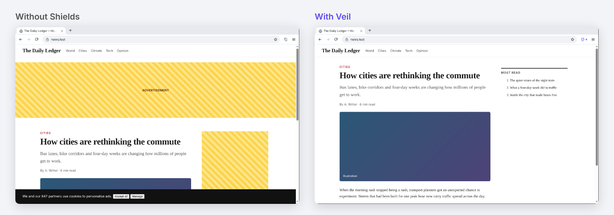
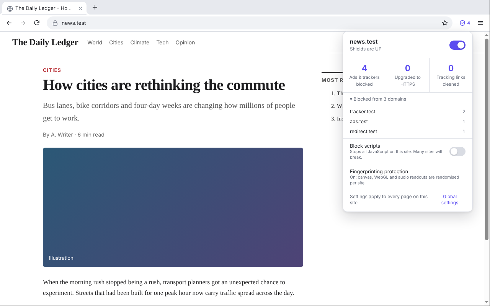
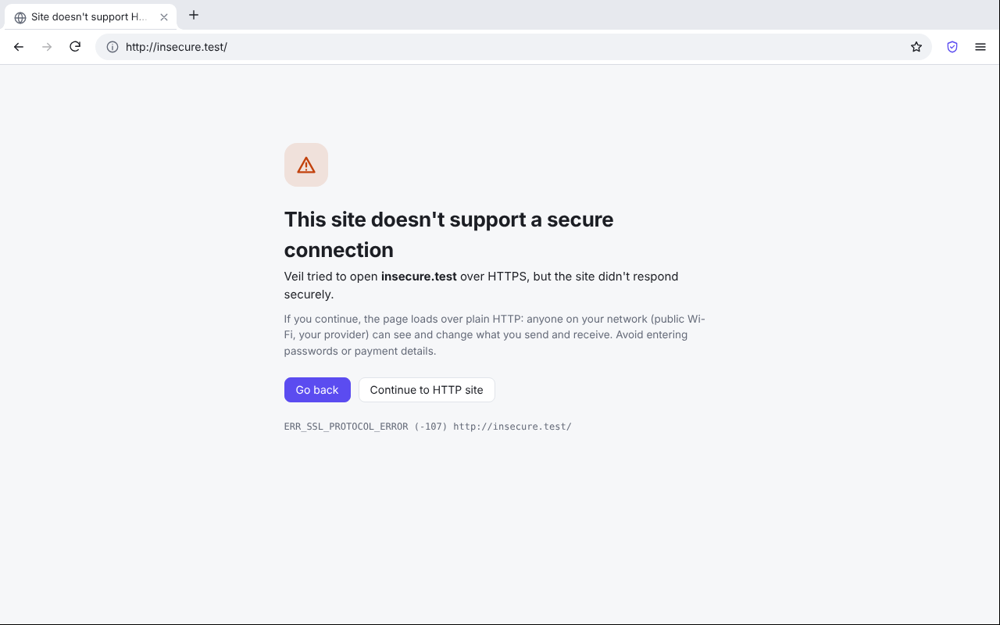
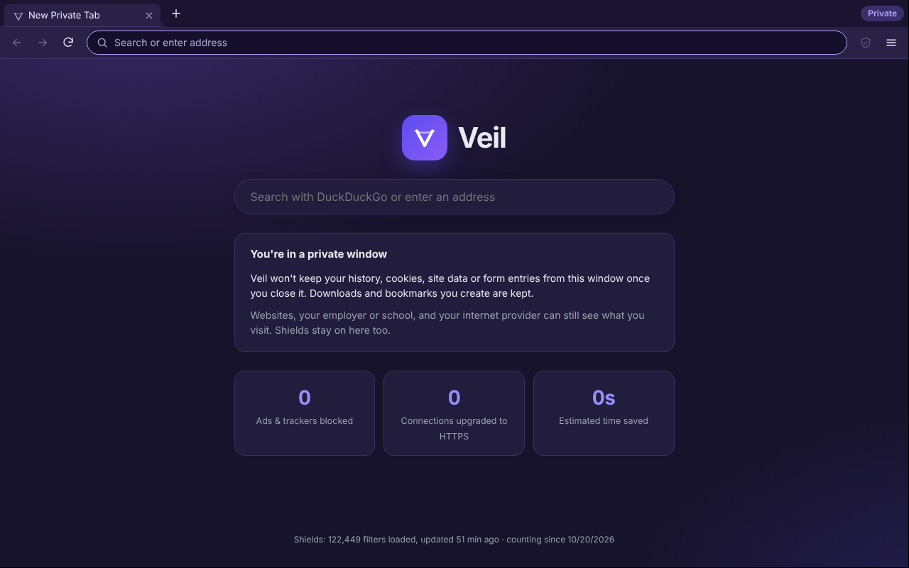
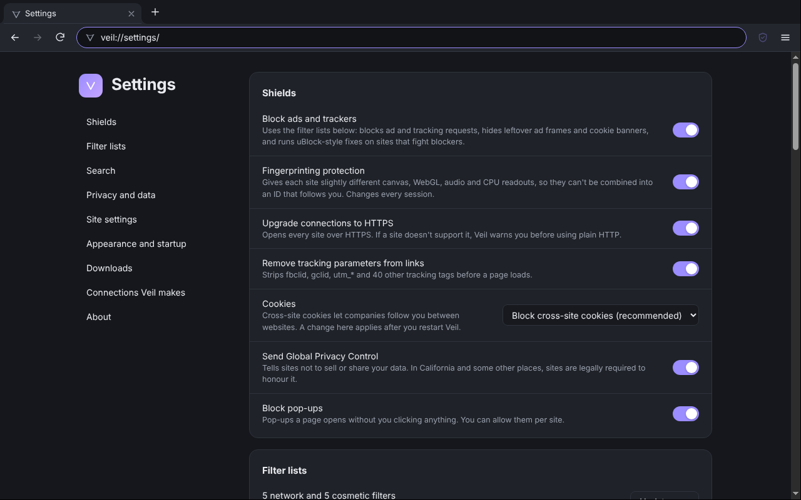
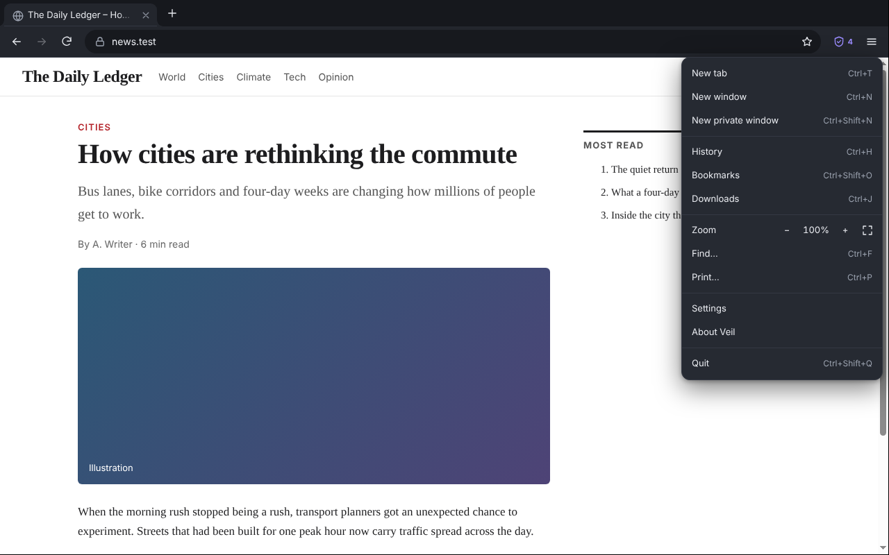
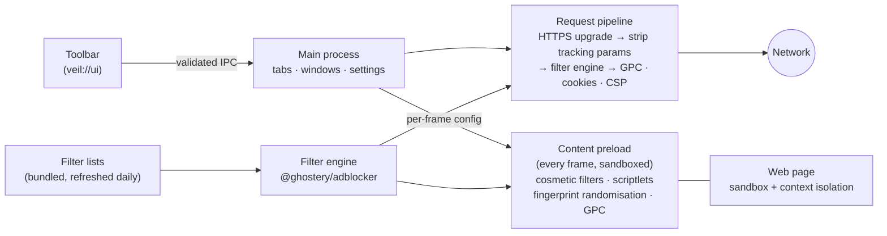

<div align="center">


# Veil

**The private browser with Shields built in.**

Veil blocks ads, trackers, cookie banners and fingerprinting out of the box, opens every site over HTTPS,
and sends nothing to Google or to us. It runs on Chromium, so the web works the way you expect.

[](https://github.com/Ethos6/veil/actions/workflows/ci.yml)
[](https://github.com/Ethos6/veil/releases/latest)
[](LICENSE)


[Download](#download) · [What Shields do](#what-shields-do) · [Compared with](#how-veil-compares) · [Connections](#every-connection-veil-makes) · [Build](#build-from-source) · [Limits](#known-limits)



<sub>A demo page from Veil's own test suite, with Shields down and up.</sub>

</div>

## Why Veil

[ungoogled-chromium](https://github.com/ungoogled-software/ungoogled-chromium) shows how much of Chromium talks to Google, and removes it. It deliberately stops there: no ad blocking, privacy features mostly opt-in, and you build or find a binary yourself. [Brave](https://brave.com) blocks ads and trackers by default but comes with its own services, rewards and crypto wallet.

Veil sits between them: a small, readable browser where **privacy is the default and nothing else is attached**.

- **Shields on from the first page.** uBlock Origin–grade filter lists (EasyList, EasyPrivacy, uBlock filters, Peter Lowe's list and cookie-notice lists) compiled into one fast engine, with no extension needed.
- **Nothing phones home.** No Google services, no telemetry, no crash reports, no account, no sync, no ads, no crypto. You can see and switch off the [only connections Veil makes](#every-connection-veil-makes) on its own.
- **Installers for every platform**, built in public by GitHub Actions from this repository.
- **About 5,000 lines you can read.** Every feature is covered by end-to-end tests that drive the real browser against local test sites.

## What Shields do



| | |
| --- | --- |
| **Ads and trackers** | Network requests matching the filter lists are stopped before they leave your computer. Scripts some sites depend on are swapped for harmless stand-ins (uBlock-style redirects), so pages don't break. |
| **Cosmetic filtering** | Empty ad frames and cookie banners are hidden, including ones added after the page loads. uBlock Origin's scriptlets run before the page's own code to defeat anti-adblock tricks. |
| **Scam and malware pages** | Pages on the uBlock badware list, and whole-host tracker domains, are stopped with a warning you can click through. |
| **Cross-site cookies** | Blocked inside Chromium itself, so scripts, frames and service workers can't get around it. Sites that need them (embedded logins) can ask through the Storage Access API, and Veil asks you. |
| **Fingerprinting** | Canvas, WebGL and audio readouts get tiny changes, Brave-style: stable on one site during a session, different on every other site and after every restart, so they can't be joined into an ID. The GPU model is hidden, and the Battery API is removed. |
| **HTTPS everywhere** | Every `http://` address is opened over HTTPS. If a site doesn't support it, you get a clear warning first instead of a silent downgrade. |
| **Tracking links** | `fbclid`, `gclid`, `utm_*` and 40 other tracking parameters are removed before the request is sent. |
| **Global Privacy Control** | Sent on every request and visible to pages (`Sec-GPC: 1`, `navigator.globalPrivacyControl`). |
| **Pop-ups and downloads** | Pop-ups and downloads that a page starts without a click are held until you allow them. |

Shields can be turned off per site from the toolbar; per-site script blocking is one more switch. Everything else is on [veil://settings](#screenshots).

### No Google, no Electron fingerprints

- **No Google services:**
  - No Safe Browsing, sync, sign-in, translate or update pings.
  - Spell-check dictionaries are never downloaded (macOS uses its own checker).
  - Geolocation is refused rather than sent to a network location service.
- **Ad APIs switched off:** Chromium's Privacy Sandbox advertising APIs (Topics, Protected Audience/FLEDGE, Attribution Reporting, Shared Storage, Private Aggregation, Fenced Frames) are disabled.
- **Looks like Chrome:** Veil sends a plain Chrome user agent and client hints, with no "Electron" or "Veil" in them. Web pages can't load Veil's internal pages or files, so they can't detect Veil that way either.
- **Local-only suggestions:** address-bar suggestions come from your own history and bookmarks. Nothing you type is sent anywhere until you press Enter.

## Download

Get the latest installer from [**Releases**](https://github.com/Ethos6/veil/releases/latest):

| Platform | File | Notes |
| --- | --- | --- |
| Windows 10/11 (x64) | `Veil-x.y.z-win-x64.exe` | The installer isn't code-signed yet, so SmartScreen will warn: choose **More info → Run anyway**. |
| macOS 12+ (Apple silicon) | `Veil-x.y.z-mac-arm64.dmg` | Not notarised yet. After dragging Veil to Applications, run `xattr -dr com.apple.quarantine /Applications/Veil.app` once, or right-click → **Open**. |
| macOS 12+ (Intel) | `Veil-x.y.z-mac-x64.dmg` | As above. |
| Linux (x64) | `Veil-x.y.z-linux-amd64.deb` or `Veil-x.y.z-linux-x86_64.AppImage` | Debian/Ubuntu: `sudo apt install ./Veil-*.deb` (recommended: it sets up Chromium's sandbox properly). AppImage: `chmod +x` and run; on Ubuntu 24.04+ AppImages of Chromium-based apps need an AppArmor profile, so prefer the .deb there. |

Each release lists SHA-256 checksums of its files (`SHA256SUMS.txt`). Veil checks GitHub once a day for a newer version and tells you; it never downloads or installs anything on its own.

## How Veil compares

| | Veil | ungoogled-chromium | Brave | Chrome |
| --- | :---: | :---: | :---: | :---: |
| Ad and tracker blocking built in, on by default | ✅ | ❌ | ✅ | ❌ |
| Cookie banners hidden | ✅ | ❌ | ✅ | ❌ |
| Fingerprint randomisation | ✅ | partial, opt-in flags | ✅ | ❌ |
| HTTPS-only by default | ✅ | setting | ✅ | setting, rolling out |
| Cross-site cookies blocked | ✅ | setting | ✅ | ❌ |
| Google services removed | ✅ | ✅ | mostly | ❌ |
| No telemetry or vendor services | ✅ | ✅ | opt-out telemetry, rewards, wallet | ❌ |
| Official installers for Windows, macOS, Linux | ✅ | community builds | ✅ | ✅ |
| Chrome extensions | ❌ | ✅ (manual install) | ✅ | ✅ |
| Sync | ❌ | ❌ | ✅ | ✅ |
| Widevine DRM (Netflix, Spotify web) | ❌ | ❌ | ✅ | ✅ |
| Chromium updates | follows Electron releases (days to weeks behind Chrome) | follows Chromium | follows Chromium | first |

Veil is the right choice if you want strong defaults with no services attached and a codebase small enough to audit. If you need extensions, sync or DRM, use ungoogled-chromium or Brave.

## Every connection Veil makes

Apart from the sites you visit, Veil makes only these connections on its own:

| What | When | Where | Turn off |
| --- | --- | --- | --- |
| Filter list updates | at most once a day | the list publishers (easylist.to, ublockorigin.github.io, pgl.yoyo.org, secure.fanboy.co.nz), or a GitHub mirror if one is unreachable | Settings → Connections Veil makes |
| New-version check | once a day | `api.github.com` (asks for the latest release number only) | Settings → Connections Veil makes |
| Website icons | when a page has one | the site you're on, with Shields applied and no cookies | — |

Lists and update checks use a separate in-memory session, without your cookies. Veil ships with a compiled copy of the lists, so Shields work from the first page, even offline.

## Screenshots

<table>
<tr>
<td width="50%"><br><sub><b>HTTPS-only.</b> A clear choice instead of a silent downgrade.</sub></td>
<td width="50%"><br><sub><b>Private windows.</b> Each one has its own throwaway session.</sub></td>
</tr>
<tr>
<td width="50%"><br><sub><b>Settings.</b> Every protection explained in a sentence.</sub></td>
<td width="50%"><br><sub><b>Dark mode</b>, following your system or your choice.</sub></td>
</tr>
</table>

## Features

- **Tabs:** drag to reorder, middle-click to close, reopen closed tabs (with their history), mute.
- **Address bar:** suggestions from local history and bookmarks.
- **Search engines:** DuckDuckGo by default, or Brave Search, Startpage, Mojeek, Ecosia, Qwant, Bing or Google.
- **Private windows:** separate cookies and storage per window, cleared on close, never written to history.
- **Bookmarks:** import and export in the HTML format every browser uses.
- **History:** search and delete entries, or clear a time range.
- **Downloads:** a folder of your choice, pause and resume, and no file ever overwritten.
- **Find in page, zoom, print, full screen, view source, developer tools.**
- **Permission prompts:** camera, microphone, notifications and clipboard, with remembered answers you can change per site.
- **Startup and exit:** continue where you left off, or clear everything on exit (also after a crash or OS shutdown).

### Keyboard shortcuts

| Action | Windows / Linux | macOS |
| --- | --- | --- |
| New tab / window / private window | Ctrl+T / Ctrl+N / Ctrl+Shift+N | ⌘T / ⌘N / ⌘⇧N |
| Close tab / reopen closed tab | Ctrl+W / Ctrl+Shift+T | ⌘W / ⌘⇧T |
| Address bar | Ctrl+L, Alt+D, F6 | ⌘L |
| Next / previous tab, tab 1–8, last tab | Ctrl+Tab / Ctrl+Shift+Tab, Ctrl+1–8, Ctrl+9 | ⌃Tab / ⌃⇧Tab, ⌘1–8, ⌘9 |
| Back / forward / reload | Alt+← / Alt+→ / Ctrl+R | ⌘[ / ⌘] / ⌘R |
| Find / next / previous | Ctrl+F / Ctrl+G / Ctrl+Shift+G | ⌘F / ⌘G / ⌘⇧G |
| Zoom in / out / reset | Ctrl+= / Ctrl+- / Ctrl+0 | ⌘+ / ⌘- / ⌘0 |
| Bookmark / history / downloads | Ctrl+D / Ctrl+H / Ctrl+J | ⌘D / ⌘Y / ⌘⇧J |
| Developer tools / full screen | F12 / F11 | ⌘⌥I / ⌃⌘F |

## How it works



- **Sandboxed web pages.** Every web page runs in Chromium's sandbox with context isolation and no Node.js. Veil's preload runs in every frame, in an isolated world, before the page's own code.
- **One request pipeline.** All network requests go through a single pipeline in the main process, in this order: HTTPS upgrade, tracking-parameter removal, then the filter engine. Response headers then get `$csp` policies and cookie rules.
- **Internal pages.**
  - Veil's pages (`veil://settings`, `veil://history`, …) are served from inside the app with a strict Content-Security-Policy, and can't be framed or loaded by websites.
  - They talk to the browser through a small, validated API that only `veil://` pages get.
- **Hardened build.** Installers have Electron's [fuses](https://www.electronjs.org/docs/latest/tutorial/fuses) set:
  - Off: run-as-node, `NODE_OPTIONS` and the inspector.
  - On: cookie encryption, and ASAR integrity checking with load-from-ASAR-only.

## Build from source

You need Node.js 22 or newer.

```bash
git clone https://github.com/Ethos6/veil.git
cd veil
npm ci
npm run lists    # download the filter lists and compile resources/engine.bin
npm start        # run Veil from source
npm run dist     # build installers for your platform into dist/
```

`npm start -- --profile=/tmp/veil-test` runs with a separate profile folder.

## Testing

- **`npm test`:** 36 unit tests of the pure logic:
  - URL clean-up, HTTPS upgrade rules, public-suffix handling
  - the request pipeline's decisions
  - filter-engine behaviour, list download with mirror fallback, corrupt-file recovery
  - address-bar parsing, settings validation, shortcuts, path safety, bookmark import/export
- **`npm run test:e2e`:** 39 end-to-end tests that run the real Veil (Electron, under Xvfb on Linux) against local HTTP and HTTPS test sites, using fixed test filter lists. They check, among other things:
  - **Blocking:** ad blocking and redirects, cosmetic filters and scriptlets.
  - **Cookies:** cross-site cookie blocking, including the about:blank and service-worker routes.
  - **Fingerprinting:** randomisation per site, plus frames reached by index.
  - **HTTPS:** the HTTPS-only fallback and redirect loops.
  - **Pages and links:** scam-page blocking, pop-up blocking, POST forms in new tabs, `window.open`.
  - **Isolation:** web pages can't reach `veil://`, and private windows are kept separate.
  - **Browser features:** downloads, permissions, find, bookmarks, history, settings, and a narrow window.
- **`npm run typecheck`:** TypeScript over the main-process JavaScript.

CI runs the unit tests and type check on Linux, macOS and Windows, and the end-to-end tests and a packaging smoke test on Linux.

## Known limits

Veil is honest about what it doesn't do (yet):

- **No extensions, sync or DRM.** Shields cover what an ad-blocking extension would. Widevine isn't available in Electron builds, so Netflix and Spotify's web player won't play.
- **Chromium version.** Veil uses the Chromium inside Electron, which picks up Chrome's security fixes within days to weeks. Keep Veil updated; Dependabot keeps Electron current here.
- **Fingerprinting protection runs in pages and frames, not in workers.** A canvas drawn inside a Web Worker isn't randomised, and font lists aren't masked. It raises the cost of fingerprinting a lot; it doesn't make you invisible.
- **No HTTP Basic-auth dialog** yet, so pages that need one (some routers) can't be opened.
- **Unsigned installers** until code-signing certificates are in place (see [Download](#download)).
- A change to the cookie setting takes effect after a restart.

## Credits

- **[ungoogled-chromium](https://github.com/ungoogled-software/ungoogled-chromium), [Brave](https://github.com/brave/brave-browser) and [uBlock Origin](https://github.com/gorhill/uBlock).** Veil shares no code with them, but builds on their ideas of a browser that works for its user. The fingerprint randomisation follows the approach Brave calls "farbling".
- **[@ghostery/adblocker](https://github.com/ghostery/adblocker)** (MPL-2.0, used unmodified) is the filter engine.
- **The filter lists:**
  - [EasyList and EasyPrivacy](https://easylist.to)
  - [uBlock Origin's uAssets](https://github.com/uBlockOrigin/uAssets)
  - [Peter Lowe's list](https://pgl.yoyo.org/adservers/)
  - [Fanboy's cookie list](https://secure.fanboy.co.nz)
  
  Each is maintained by its authors, under its own licence, and downloaded from its publisher.
- **[Electron](https://www.electronjs.org)** and **[Chromium](https://www.chromium.org)**. Public suffix lookups use **[tldts](https://github.com/remusao/tldts)**.

## License

[MIT](LICENSE) © 2026 Ethos 6. Third-party components keep their own licences; see [Credits](#credits).
